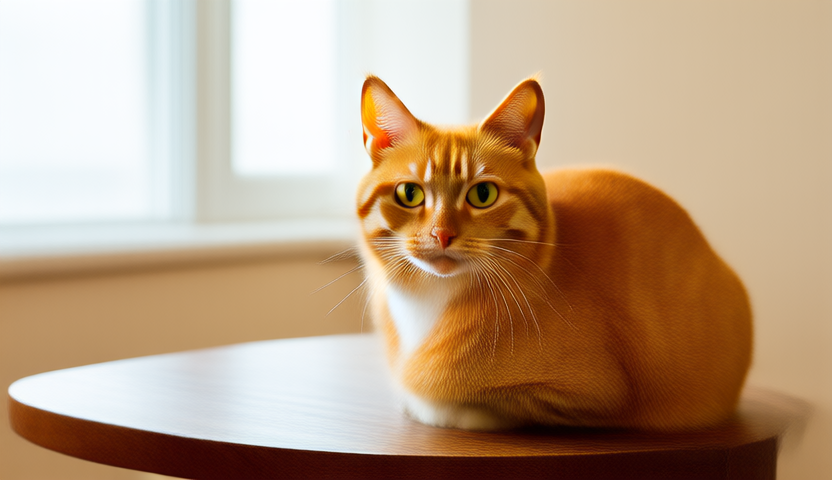

# Prüfbericht – AVEN Video AI 3.4

Stand: 3. November 2026. Ausgangspunkt: GitHub `main`, Commit `e708dd8172b29992c28d9f29a0bbab292b829a0f` (AVEN v3.3 VACE Modellfix). Änderungen liegen im lokalen Branch `fix/wan-quality-and-media`.

## Befund am tatsächlichen Projekt

Die zwei vorhandenen MP4s wurden aus den bereits hochgeladenen Dateien geöffnet und dekodiert. Beide haben 352×192 Pixel, 6 FPS und 2 Sekunden Laufzeit. In den sichtbaren Bildern dominieren unscharfe violette Strukturen; die bloße MP4-Erstellung ist kein Qualitätserfolg.

Das verfügbare alte `engine.log` endet noch mit dem fehlenden `vace_patch_embedding.weight`-Tensor und gehört zum fehlgeschlagenen älteren Modell. Ein Original-PNG und das erfolgreiche v3.3-Log waren in den vorhandenen Dateien nicht verfügbar. Damit lässt sich rückwirkend nicht beweisen, wie viel der Unschärfe auf Sampling, Gewichte oder VAE entfiel. Insbesondere wird kein unbewiesener Farbkanalfehler als Hauptursache behauptet.

Im Quellcode sind diese problematischen Einstellungen und Fehler bestätigt:

| Bereich | Bisher | Änderung |
|---|---|---|
| Kleine Qualitätsstufen | 6–14 Schritte, teils 352×192 | Mindestens 20 Schritte und 480p; kein Minimalprofil mit praktisch unbrauchbarer Ausgabe |
| Modellparameter | Generischer Flow-Shift 3, CFG 5,5 fest im Aufruf | Für VACE Euler/discrete, Flow-Shift 16, CFG 5; Werte kommen aus dem gespeicherten Profil |
| Zeitbasis | 6 FPS; kurze 9-Frame-Segmente | 16 FPS, 33 Originalframes pro Sequenz; kurze Tests passen in eine Sequenz |
| Hardware | Auflösung/Frames/Gewichte abhängig vom RAM | Gleiche angeforderte Qualitätsparameter; nur Ausführung/Threads hardwareabhängig |
| Präzision | Angefordertes Q8 konnte still zu Q4 werden | Start wird bei fehlenden Q8/Q5-Gewichten abgelehnt |
| Musiklänge | KI-Auftrag still auf 240 s begrenzt | Gesamte Audiospurdauer inklusive Nachkommastellen; keine 240-s-Kürzung |
| Ausgabe | PNGs nur grob gesammelt, beschädigte Frames teils übersprungen | Exakte Nummernfolge/Anzahl/Größe/Lesbarkeit und Diagnosebericht |
| Wiederaufnahme | Teilweise alte Dateien im gleichen Szenenordner | Unterbrochene Szene archivieren, neue Ausgabe isolieren; alte fehlerhafte Profile blockieren |
| Abbruch | Erfolgsmeldung konnte nach einem Abbruch erscheinen | Atomare Freigabe der Ergebnisveröffentlichung und Abbruchprüfungen in Kodierung/Export |
| Normaler Bildexport | Abrunden der Framezahl und Musikschleifen | Aufrunden, exaktes Sessionende und gemeinsamer Musikexport ohne Schleife |
| Reproduzierbarkeit | Build verwendete wechselndes Engine-`master` | Fester Engine-Commit, feste Modellrevisionen, SHA256 und gespeicherter CLI-Aufruf |

Die bisherigen Root-Tests enthielten veraltete Textprüfungen und schlugen bereits auf dem unveränderten v3.3-Stand fehl. Sie wurden durch ausführbare Logiktests und echte native Medientests ergänzt/ersetzt.

## Tatsächlich durchgeführte Prüfungen

| Prüfung | Status | Aussage |
|---|---|---|
| Projektübergabe vollständig gelesen und `main` geprüft | Durchgeführt | Code basiert auf dem bestehenden Projekt |
| Beide bisherigen MP4s dekodiert und Stichproben angesehen | Durchgeführt | Ausgabeproblem bestätigt; erfolgreiche Originalframes fehlen |
| Swift-Logiktests kompiliert und ausgeführt | Bestanden | 20 Hardware-/Qualitätsvergleiche, 140 Hardware-/Stufen-Kombinationen in drei Formaten; CLI, Seeds, Framefolge, vollständige PNG-Chunks/CRC, Dauer und alte Aufträge |
| Regression vor Änderung | Fehler nachgewiesen | Alter Mindestwert 6 Schritte; Überlauf bei extrem großer Länge; fehlende Abbruch-Veröffentlichungssperre und fehlende Teilframeplanung |
| Neue Abbruch-/Teilframe-Regressionen | Bestanden | Abbruch vor der Ergebnisveröffentlichung gewinnt; 5,375 s bei 12 FPS benötigen 65 Frames mit gekürztem letztem Frame |
| Swift-Syntax aller App-Dateien | Bestanden | Syntaxprüfung mit Swift 6.2.3 im Swift-5-Modus; kein macOS-Typecheck |
| Paket-/Shell-/Workflow-Prüfungen | Bestanden | Info.plist, Engine-Pin, Bash-Syntax und identische sichtbare Workflow-Kopie |
| Engine auf Linux aus dem festgeschriebenen Commit kompiliert | Bestanden | `sd-cli` startet; benötigte CLI-Optionen vorhanden |
| Q4-, UMT5-Q3- und VAE-Dateien vollständig gehasht | Bestanden | SHA256 stimmen mit den festgeschriebenen Quellen überein |
| Echte CPU-Generierung | Erfolgreich | 832×480, 1 Frame, 20 Schritte, Q4/UMT5-Q3/offizielle VAE; Exit 0 nach 2.543 s (42 min 23 s) |
| Original-PNG dekodiert, visuell beurteilt und CRC geprüft | Bestanden | Klar erkennbares Katzenmotiv mit detaillierten Augen/Fell/Barthaaren; gültige PNG-Chunks und Prüfsummen |

## Ergebnis der echten Modellberechnung

Der Test hat ein erkennbares Katzenmotiv passend zum englischen Prompt erzeugt. Augen, Fell und Barthaare sind klar ausgearbeitet; die Unschärfe liegt überwiegend im beabsichtigten Hintergrund. Das Originalbild wurde nicht nachgeschärft oder hochskaliert. Die kompakten Q4-/Q3-Gewichte können in dieser Kombination also brauchbare Bildstruktur erzeugen. Aus diesem Test folgt nicht, dass Quantisierung bei anderen Motiven keinen Einfluss hat oder dass die alte Fehlkonfiguration damit einzeln kausal isoliert wurde.

Der Lauf verwendete 4 CPU-Threads und **einen** Frame. Sampling benötigte etwa 113 Sekunden pro Schritt; insgesamt wurden 2.543 Sekunden gemessen. Das ist eine Messung dieser Linux-Umgebung, keine Geschwindigkeitszusage für deinen Mac. Ein 33-Frame-Video benötigt wesentlich mehr Arbeit und ist damit noch nicht überprüft.

Das unveränderte PNG, `engine.log`, `command.json` und `result.json` liegen in `docs/validation/linux-single-frame/`. Alle drei eingesetzten Gewichtsdateien wurden vor dem Test vollständig gehasht. Ein vollständiger Videolauf, Referenzmodus und Metal bleiben separate Prüfungen.

Der Linux-Engine-Build lief mit deaktivierten GPU-Backends und generischer CPU-Zielarchitektur. Er ersetzt keinen Intel-macOS-/Metal-Test.

## Vorbereitete Prüfungen, die hier nicht ausgeführt werden konnten

Die Umgebung ist Linux. Sie enthält weder Apple-SDK noch macOS-Laufzeit. GitHub verweigerte den Versuch, einen Arbeitsbranch anzulegen, mit HTTP 403. Ein direkter Git-Push wurde zusätzlich durch die automatische Freigabeprüfung blockiert: Sie verlangt eine ausdrückliche Zustimmung zum Hochladen des geänderten Quellcodes in das Ziel-Repository. Es wurden **keine Änderungen gepusht**, kein Pull Request angelegt und keine neuen Mac-Builds ausgelöst.

`tests/test_on_mac.sh` führt auf macOS die folgenden Integrationstests aus:

- Echte PNG-Dateien, exakte Bildgröße/Anzahl und numerische Reihenfolge.
- JPEG-EXIF-Drehung und Bildextraktion aus einem echten MP4.
- Beschädigte/abgeschnittene PNGs und fast einfarbige Ausgabe.
- 33 Originalframes → H.264-MP4 → Dekodierung: Framezahl, Farben, Orientierung und genaue Clipdauer.
- Zusammensetzen und Kürzen von Clips; zu kurze Clipfolge wird abgelehnt.
- Ganze WAV-Musik mit Nachkommastellen, lesbare Audiospur, Tonhöhe und Ton am Ende.
- VBR-MP3 ohne Xing-Header mit unabhängig gezählter Paketdauer.
- Bildanimations-Export auf volle, nicht ganzzahlige Songdauer.
- Abbruch vor/während der Kodierung; keine Veröffentlichung einer Teil-MP4.

Diese Tests sind **hinzugefügt und syntaktisch geprüft, aber auf macOS noch nicht gelaufen**. Die Buildprüfung prüft danach App/Engine-Architektur, CLI-Optionen, externe Bibliotheksabhängigkeiten, eingebettete Metal-Bibliothek, Signatur und DMG. Auch diese neuen Mac-Builds sind erst nach dem Hochladen möglich.

Beide Jobs (x86_64 und arm64) sowie beide Installer-Artifacts des bisherigen v3.3-Laufs wurden erneut geprüft: erfolgreich und vorhanden. `main` ist weiterhin unverändert auf dem Ausgangscommit.

Der letzte erfolgreiche GitHub-Build [41574762412](https://github.com/vetonju-hub/AVEN-Video-AI/actions/runs/41574762412) gehört zum unveränderten Ausgangscommit v3.3 und ist kein Beleg für v3.4.

## Bewusst verbleibende Grenzen

Ein Einzelbildtest beweist keine bewegte 33-Frame-Generierung. Technische Bildmetriken beweisen weder erkennbare Objekte noch Fotorealismus. Q8/UMT5-Q5 sowie Apple-Metal benötigen eigene Generierungsläufe. Der aktuelle Videoimport übernimmt ein Referenzbild statt einer vollständigen Video-zu-Video-Bearbeitung. Lange Videos bestehen aus unabhängigen Szenen mit möglichen Schnitten. Unter 8 GB wird dieses Wan-Modell nicht gestartet; auch auf 16 GB besteht keine Speicher-/Geschwindigkeitsgarantie. Eine Windows-Version ist nicht Bestandteil dieses Updates.

## Technische Referenzen

- [Engine-Wan-Anleitung, festgeschriebener Commit](https://github.com/leejet/stable-diffusion.cpp/blob/d30854463dbc75fb3671209b79016bb0d8ac321e/docs/wan.md)
- [VACE-Rezept: CFG 5, Flow-Shift 16, 20 Schritte und 480p](https://github.com/leejet/stable-diffusion.cpp/blob/d30854463dbc75fb3671209b79016bb0d8ac321e/examples/server/recipes/wan21-vace.json)
- [Offizielle Wan-VACE-Implementierung](https://github.com/Wan-Video/Wan2.1/blob/main/generate.py)
- [Apple: genaue Dauer für Kompositionen und MP3](https://developer.apple.com/library/archive/documentation/AudioVideo/Conceptual/AVFoundationPG/Articles/01_UsingAssets.html)
- [Gewichtsquellen und SHA256](MODELLQUELLEN.md)
